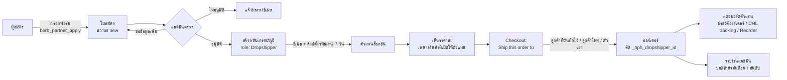

# Herb Partner Hub

ปลั๊กอิน WordPress + WooCommerce สำหรับทำ **โปรแกรมตัวแทน Dropshipper**
ตัวแทนสมัครผ่านหน้าเว็บ แอดมินอนุมัติ แล้วตัวแทนจะซื้อสินค้าได้ใน **ราคาส่ง** และสั่งให้ร้านส่งของไปถึง **ลูกค้าของตัวแทนเอง** ได้โดยตรง

ตัวแทนได้กำไรจากส่วนต่างระหว่างราคาส่งกับราคาที่ตัวเองขายให้ลูกค้า โปรแกรมนี้**ไม่มีระบบค่าคอมมิชชั่น**

| | |
|---|---|
| เวอร์ชัน | 0.1.0 |
| ต้องการ | WordPress 6.5+, PHP 8.1+, WooCommerce 8.0+ |
| รองรับ | HPOS (High-Performance Order Storage) และการเก็บออร์เดอร์แบบ posts table |

---

## ภาพรวมการทำงาน



### 1. ใครคือ "ตัวแทน" (หัวใจของระบบ)
ทุกโมดูลใช้ฟังก์ชันเดียวกันคือ `hph_is_dropshipper()` (`includes/class-hph-context.php`) ในการตัดสินว่าจะแสดงผลแบบตัวแทนหรือไม่ ฟังก์ชันนี้คืนค่า `true` เมื่อเงื่อนไขครบทุกข้อ:

- เป็น request ฝั่งหน้าร้าน ไม่ใช่ wp-admin, cron, WP-CLI หรือ REST (ยกเว้น Store API)
- ผู้ใช้มี role `herb_dropshipper` และ `_hph_status = active`
- ผู้ใช้ไม่ใช่คนดูแลโปรแกรม คือไม่มี capability `hph_manage`
- ปิด soft launch อยู่ หรือผู้ใช้มีชื่ออยู่ในรายชื่อ soft launch

แอดมินกด **"View as dropshipper"** บน admin bar ได้ เพื่อดูหน้าร้านแบบเดียวกับที่ตัวแทนเห็น โหมดนี้มีผลกับบัญชีของแอดมินคนนั้นคนเดียว

### 2. ปลอดภัยตอนติดตั้งบนเว็บจริง
หลังเปิดใช้ปลั๊กอิน **ทุกโมดูลจะถูกปิดไว้** และ **soft launch ถูกเปิดโดยยังไม่มีรายชื่อใคร** ลูกค้าทั่วไปจึงไม่เห็นอะไรเปลี่ยน
จากนั้นค่อยเปิดทีละโมดูลที่ **Dropshippers › Settings** แล้วใส่ user ID ของตัวแทนที่จะทดลองลงในรายชื่อ soft launch

---

## โมดูล

โมดูลจะโหลดก็ต่อเมื่อเปิดสวิตช์ไว้ และมีไฟล์ `includes/<key>/class-hph-<key>.php` อยู่จริง

| โมดูล | หน้าที่ |
|---|---|
| **applications** | ฟอร์มสมัคร `[herb_partner_apply]` (จำกัด 5 ครั้งต่อ IP ต่อชั่วโมง) หน้า Applications ให้แอดมินอนุมัติ / ขอข้อมูลเพิ่ม / ไม่อนุมัติ อีเมล WooCommerce 5 แบบ และลิงก์ตั้งรหัสผ่านอายุ 7 วันที่ล็อกอินให้ทันทีหลังตั้งรหัสเสร็จ |
| **pricing** | ตั้งราคาส่ง (`_hph_price`) ได้ทั้งรายสินค้าและราย variation ตัวแทนจะเห็นราคาส่งพร้อมราคาปลีกแบบขีดฆ่า สินค้าที่ไม่ได้เปิดให้ตัวแทนจะถูกซ่อน เปิดหน้าสินค้าจะได้ 404 และซื้อไม่ได้แม้ใช้ลิงก์ `?add-to-cart=` ตรง ๆ มีหน้า Dropshippers › Products สำหรับแก้หลายรายการพร้อมกัน และ export/import CSV |
| **discounts** | ไม่ให้โปรโมชันทุกแบบใช้กับตัวแทน ได้แก่ Stherb Promo Engine, Woo Discount Rules, Tier Pricing Table, คูปองของ WooCommerce และ Power Coupons |
| **customers** | หน้า My Account › My Customers ให้ตัวแทนเก็บรายชื่อลูกค้าของตัวเอง แต่ละคนเห็นเฉพาะของตัวเอง ตอน checkout เลือกได้ว่า "Ship this order to" ลูกค้าที่บันทึกไว้ ลูกค้าใหม่ หรือตัวเอง แล้วเซิร์ฟเวอร์จะกรอกที่อยู่และเบอร์โทรให้ ชื่อและที่อยู่ billing จะเป็นของลูกค้าปลายทาง (ใช้ทำใบศุลกากร) แต่ billing email ยังเป็นของตัวแทน ใบเสร็จจึงส่งถึงตัวแทน และที่อยู่ในโปรไฟล์ของตัวแทนจะไม่ถูกเขียนทับ |
| **orders** | แดชบอร์ดตัวแทนบนหน้าแรกของ My Account ประวัติออร์เดอร์ที่บอกว่าส่งให้ใคร เลข DHL tracking (อ่านจาก order notes) ตัวกรอง export CSV และปุ่ม Reorder ที่เลือกผู้รับคนเดิมให้ตอน checkout |
| **reports** | หน้า Dropshippers › Overview แสดงยอดขายรายเดือน จำนวนตัวแทนที่ active ใบสมัครที่รอตรวจ อันดับตัวแทน และ export CSV |

### นิยาม "ยอดขายตัวแทน" (`HPH_Sales`)
แดชบอร์ดตัวแทน ประวัติออร์เดอร์ และรายงานแอดมินใช้นิยามเดียวกัน ตัวเลขของเดือนเดียวกันจึงตรงกันทุกหน้า:
- นับเฉพาะออร์เดอร์ที่มี `_hph_dropshipper_id` คือสั่งในราคาตัวแทน ออร์เดอร์ที่คนเดียวกันสั่งก่อนได้รับอนุมัติไม่นับ
- สถานะที่นับ: `processing`, `completed`, `on-hold`
- ออร์เดอร์ `refunded` ยังรวมในยอดเงินตามจำนวนที่เหลือหลังคืนเงิน แต่ไม่นับเป็นจำนวนออร์เดอร์
- ยอดเงิน = ที่ตัวแทนจ่ายจริงรวมค่าส่ง หักยอดคืนเงิน
- แบ่งเดือนตามปฏิทินใน time zone ของเว็บ

---

## ข้อมูลที่ปลั๊กอินเก็บ

| ที่เก็บ | รายละเอียด |
|---|---|
| ตาราง `{prefix}hph_applications` | ใบสมัครและผลการตรวจ |
| ตาราง `{prefix}hph_end_customers` | ลูกค้าปลายทางของตัวแทนแต่ละคน เมื่อลบ ข้อมูลส่วนตัวในแถวจะถูกล้างทิ้ง แต่ยังเก็บแถวเปล่าไว้ให้ออร์เดอร์เก่าอ้างถึงได้ ส่วนที่อยู่ในออร์เดอร์เก่าไม่ถูกแตะ เพราะเป็นหลักฐานภาษีและ DHL |
| ตาราง `{prefix}hph_log` | activity log บันทึกว่าใครเปลี่ยนอะไร ค่าก่อนและหลัง |
| option `hph_settings` | สวิตช์โมดูล, soft launch, หน้าเงื่อนไข และอื่น ๆ |
| role `herb_dropshipper` | role ของตัวแทน |
| capabilities | `hph_manage` (แอดมิน), `hph_view_reports` (แอดมิน + shop manager) |
| user meta | `_hph_status`, `_hph_view_as`, `_hph_setpw_until` |
| product meta | `_hph_enabled`, `_hph_price` |
| order meta | `_hph_dropshipper_id`, `_hph_price_list`, `_hph_ship_to`, `_hph_end_customer_id` |

ถ้าปิดใช้งานปลั๊กอิน ข้อมูลทั้งหมดยังอยู่ ข้อมูลจะถูกลบตอน uninstall เฉพาะเมื่อเปิดตัวเลือก `delete_data_on_uninstall` ไว้ใน Settings แต่ order meta (`_hph_*`) จะถูกเก็บไว้เสมอ เพราะออร์เดอร์เป็นหลักฐานภาษีและการจัดส่ง

---

## โครงสร้างโปรเจกต์

```
.
├── herb-partner-hub/          ← ตัวปลั๊กอิน (โฟลเดอร์นี้คือสิ่งที่ zip ไปติดตั้ง)
│   ├── herb-partner-hub.php   ← ไฟล์หลัก: header ของปลั๊กอิน + โหลดคลาสแกน
│   ├── includes/
│   │   ├── class-hph-*.php    ← แกน: plugin, install, settings, context, sales, admin, log, assets
│   │   ├── applications/      ← ฟอร์มสมัคร + การอนุมัติ
│   │   ├── pricing/           ← ราคาส่ง + catalog + หน้า Products
│   │   ├── discounts/         ← บล็อกโปรโมชัน
│   │   ├── customers/         ← My Customers + Ship to ตอน checkout
│   │   ├── orders/            ← แดชบอร์ด + ประวัติออร์เดอร์
│   │   ├── reports/           ← Overview ของแอดมิน
│   │   └── emails/            ← อีเมล WooCommerce 5 แบบ
│   ├── templates/             ← หน้า My Account, ฟอร์มสมัคร, checkout, อีเมล
│   ├── assets/                ← CSS / JS
│   ├── languages/
│   └── uninstall.php
└── tests/                     ← functional tests บน Docker (ดู tests/README.md)
```

---

## ติดตั้ง

1. zip โฟลเดอร์ `herb-partner-hub/`
   ```sh
   zip -r herb-partner-hub-0.1.0.zip herb-partner-hub -x '*.DS_Store'
   ```
2. ใน WordPress ไปที่ Plugins › Add New › Upload แล้วเลือกไฟล์ zip และกด Activate
3. ไปที่ **Dropshippers › Settings** เปิดโมดูลที่ต้องการ แล้วใส่ user ID ของตัวแทนทดลองลงในรายชื่อ soft launch
4. สร้างหน้าสมัครตัวแทนโดยใส่ shortcode `[herb_partner_apply]`
5. แก้สินค้าที่จะเปิดให้ตัวแทน โดยติ๊กเปิดและใส่ราคาส่ง ทำได้ในหน้าแก้สินค้าหรือที่ Dropshippers › Products

## ทดสอบ

เทสต์รันใน WordPress + WooCommerce บน Docker ที่สร้างขึ้นมาใช้แล้วทิ้ง (port 8090)
**ห้ามรันกับเว็บจริง** เพราะเทสต์จะสร้าง user และสินค้า และเขียนทับ settings

```sh
cd tests
docker compose up -d
# ขั้นตอนเตรียมระบบทั้งหมดอยู่ใน tests/README.md
sh run-all.sh
```

ตรวจ syntax ของไฟล์ PHP ทั้งหมดได้โดยไม่ต้องใช้ Docker:
```sh
find herb-partner-hub -name '*.php' -exec php -l {} \;
```

## Changelog
ดูได้ที่ [`herb-partner-hub/readme.txt`](herb-partner-hub/readme.txt)
